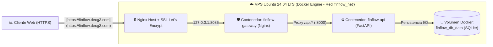

# ⚡ FinFlow Cloud — Arquitectura de Software Escalable


Prototipo funcional desarrollado para el curso de **Arquitectura de Software** (_Actividad 2: Orquestando códigos: La sinfonía de los sistemas_). Implementa una solución **Cloud-Native** modular y contenerizada para la gestión financiera, control de gastos operativos y monitoreo presupuestal en tiempo real de la empresa _FinFlow S.A.S._

---

## 🌐 Entorno Cloud en Producción (Live Demo)

El sistema se encuentra desplegado y operativo en un servidor **VPS Ubuntu 24.04 LTS** en la nube, asegurado con certificados TLS/SSL (Let's Encrypt) y orquestado con Docker Compose:

| Servicio / Recurso              | Enlace Directo en Producción                                                           | Descripción                                                                |
| :------------------------------ | :------------------------------------------------------------------------------------- | :------------------------------------------------------------------------- |
| 🖥️ **Aplicación Web (SPA)**     | [**https://finflow.decg3.com**](https://finflow.decg3.com)                             | Dashboard ejecutivo interactivo con alertas presupuestales en tiempo real. |
| 📄 **Swagger UI (OpenAPI 3.0)** | [**https://finflow.decg3.com/docs**](https://finflow.decg3.com/docs)                   | Documentación interactiva de la API REST y contratos DTO.                  |
| 🩺 **Health Check Endpoint**    | [**https://finflow.decg3.com/api/v1/health**](https://finflow.decg3.com/api/v1/health) | Monitoreo de salud del servicio ASGI y conectividad de base de datos.      |

---

## 🎯 Resumen de Requisitos Arquitectónicos

### Requisitos Funcionales (RF)

- **RF-01:** Registro transaccional de ingresos y gastos corporativos categorizados.
- **RF-02:** Consulta dinámica e historial con filtrado por categoría operativa.
- **RF-03:** Cálculo reactivo de balance neto, ingresos totales, egresos y porcentaje de ejecución.
- **RF-04:** Sistema de alerta temprana automática cuando el gasto mensual supera el **85%** del tope presupuestal.
- **RF-05:** Eliminación y depuración de registros por identificador único (`ID`).
- **RF-06:** Diagnóstico automatizado de salud de infraestructura (`/api/v1/health`).

### Requisitos No Funcionales (Atributos de Calidad)

- **RNF-01 (Escalabilidad):** Servicios _Stateless_ preparados para escalamiento horizontal mediante contenedores.
- **RNF-02 (Rendimiento):** Latencia inferior a `200 ms` (p95) impulsada por ejecución asíncrona con Uvicorn/FastAPI.
- **RNF-03 (Disponibilidad y Resiliencia):** _Uptime_ objetivo del `99.9%` mediante políticas `restart: always` y autodiagnóstico `healthcheck`.
- **RNF-04 (Seguridad):** Terminación TLS/HTTPS en el borde, aislamiento de red interna Bridge y validación estricta de payloads con Pydantic.

---

## 🏛️ Arquitectura y Patrones de Diseño Implementados

### 1. Patrones de Computación en la Nube (_Cloud Design Patterns_)

- **Gateway Routing & Gateway Offloading:** Un contenedor **Nginx** actúa como único punto de entrada, sirviendo el Frontend estático y enrutando las peticiones `/api/*` y `/docs` hacia el contenedor interno del backend, ocultando la red interna de contenedores.
- **Health Endpoint Monitoring:** El orquestador Docker consulta periódicamente el endpoint `/api/v1/health` para verificar la integridad del backend y del motor de base de datos, reiniciando el contenedor automáticamente en caso de fallo.
- **External Configuration Store:** Desacoplamiento total entre código y configuración mediante inyección de variables de entorno (`DATABASE_PATH`, `MONTHLY_BUDGET_LIMIT`).

### 2. Patrones de Diseño de Software (Backend)

- **Repository Pattern:** Abstracción total de la capa de persistencia (`TransactionRepository`), separando las sentencias SQL de la lógica de negocio financiera (`FinanceService`).
- **DTO (Data Transfer Object):** Contratos de entrada y salida tipados (`TransactionCreateDTO`, `TransactionResponseDTO`, `SummaryResponseDTO`) que previenen inyecciones de datos y garantizan integridad.
- **Dependency Injection (IoC):** Inyección limpia de dependencias en los controladores HTTP mediante `Depends()` de FastAPI.

---

## 🗺️ Topología de Despliegue en la Nube (UML Deployment)



---

## 📂 Estructura del Repositorio

```text
finflow-cloud-architecture/
├── docker-compose.yml       # Orquestación de servicios, volúmenes, redes y healthcheck
├── README.md                # Documentación integral del proyecto
├── backend/
│   ├── Dockerfile           # Construcción de imagen Python 3.11-slim para el API Server
│   ├── requirements.txt     # Dependencias del backend (FastAPI, Uvicorn, Pydantic)
│   └── main.py              # Arquitectura en capas: DTOs, Repository, Service y Controllers
└── frontend/
    ├── Dockerfile           # Construcción de imagen Nginx Alpine para Gateway y SPA
    ├── nginx.conf           # Reglas de Reverse Proxy y enrutamiento de API/Swagger
    └── index.html           # Interfaz de usuario reactiva (Tailwind CSS + Fetch API)
```

---

## 🔌 Especificación de Endpoints (API REST v1)

|  Método  | Endpoint                    | Descripción                                                   | Respuesta Exitosa |
| :------: | :-------------------------- | :------------------------------------------------------------ | :---------------: |
|  `GET`   | `/api/v1/health`            | Verifica el estado operativo de la API y la conexión a BD.    |     `200 OK`      |
|  `GET`   | `/api/v1/transactions`      | Lista las transacciones (soporta filtro `?category=`).        |     `200 OK`      |
|  `POST`  | `/api/v1/transactions`      | Registra un nuevo ingreso o gasto validado por DTO.           |   `201 Created`   |
| `DELETE` | `/api/v1/transactions/{id}` | Elimina una transacción existente por su ID.                  | `204 No Content`  |
|  `GET`   | `/api/v1/summary`           | Calcula ingresos, gastos, balance neto y alerta presupuestal. |     `200 OK`      |

---

## 🚀 Instrucciones de Despliegue (Cloud / Local)

### Requisitos previos

- **Docker** (v24+) y **Docker Compose** (v2+) instalados.

### Pasos de ejecución

1. **Clonar el repositorio:**

   ```bash
   git clone https://github.com/David-prog-wed/finflow-cloud-architecture.git
   cd finflow-cloud-architecture
   ```

2. **Construir y levantar los contenedores en segundo plano:**

   ```bash
   docker compose up -d --build
   ```

3. **Verificar el estado de salud de los contenedores:**

   ```bash
   docker compose ps
   ```

   _(El contenedor `finflow-api` mostrará el estado `Up (healthy)`)._

4. **Acceder a los servicios localmente:**
   - **Dashboard Web:** `http://localhost:8085`
   - **Documentación Swagger UI:** `http://localhost:8085/docs`
   - **Health Check JSON:** `http://localhost:8085/api/v1/health`

---

## 📚 Referencias Arquitectónicas (APA 7)

- Bass, L., Clements, P., & Kazman, R. (2021). _Software architecture in practice_ (4th ed.). Addison-Wesley.
- Fowler, M. (2002). _Patterns of enterprise application architecture_. Addison-Wesley.
- Microsoft Azure Architecture Center. (2024). _Cloud design patterns_. Microsoft Learn.
- Richards, M., & Ford, N. (2020). _Fundamentals of software architecture: An engineering approach_. O'Reilly Media.
